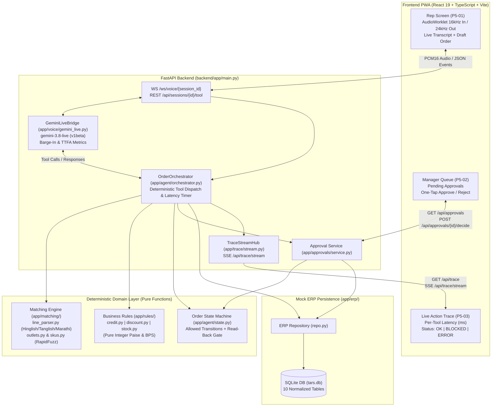
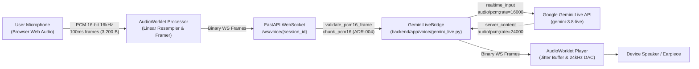
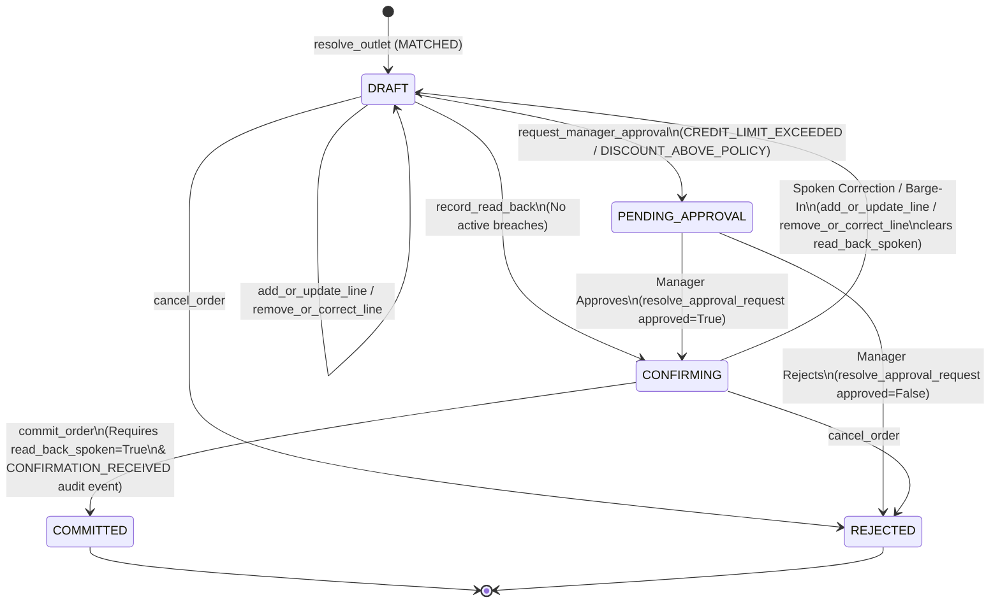
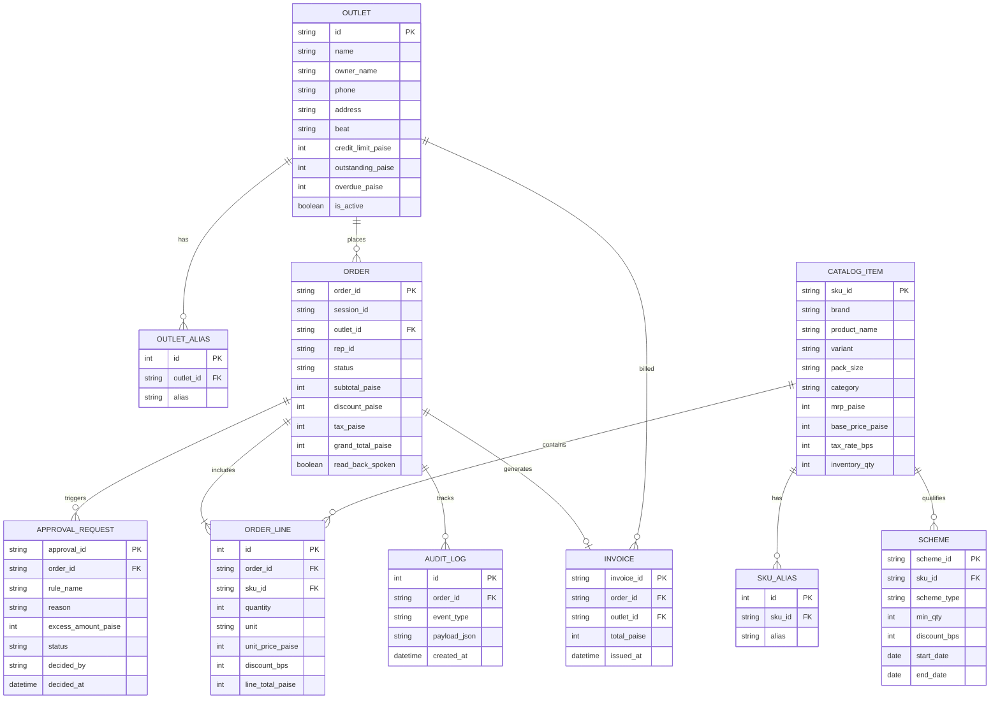

# TARS — System Architecture & Data Model

## 1. High-Level System Architecture



---

## 2. Audio Framing & Voice Streaming Pipeline

TARS uses native, bidirectional streaming audio powered by the **Gemini Live API** (`gemini-3.8-live` on `v1beta`).



### Key Audio Invariants:
1. **Input Stream:** Linear 16-bit PCM, single-channel mono, sampled at 16,000 Hz (`audio/pcm;rate=16000`). Framed into aligned chunks (multiples of 2 bytes, 100ms default chunks = 3,200 bytes).
2. **Output Stream:** Linear 16-bit PCM, single-channel mono, sampled at 24,000 Hz (`audio/pcm;rate=24000`).
3. **Barge-In (Interruption) Detection:** When the user begins speaking while the model is playing synthesized audio, the Gemini Live server emits `interrupted=True`. The bridge catches this event, marks the active turn interrupted, resets the read-back confirmation status (`read_back_spoken = False`), and transitions the order state machine back from `CONFIRMING` to `DRAFT`.
4. **Time-to-First-Audio (TTFA) Tracking:** Every speech turn and post-tool turn computes high-resolution latency from the final inbound input chunk until the first outbound PCM chunk is yielded (`[MEASURED IN REPO]: 455.6 ms`).

---

## 3. Deterministic Tool Boundary & Safety

Gemini operates in a strictly sandboxed, bounded tool environment. The LLM never has access to arbitrary SQL execution, network sockets, or ERP mutation endpoints.

The LLM is configured with **8 strict tool declarations** via `backend/app/agent/tools.py`:
1. `resolve_outlet(outlet_query: str)`: Resolves kirana store against registered distributor beat. Returns `MATCHED`, `AMBIGUOUS`, or `NOT_FOUND`.
2. `resolve_sku(product_text: str, pack_size: str | None = None)`: Resolves product and pack size against 80+ catalog items.
3. `add_or_update_line(sku_id: str, quantity: int, unit: str | None = None)`: Validates stock availability and applies best active trade schemes.
4. `remove_or_correct_line(sku_id: str, new_quantity: int = 0)`: Adjusts or deletes an existing order line and recalculates scheme qualifications.
5. `check_order_rules(outlet_id: str | None = None)`: Pure evaluation of credit headroom and discount policy caps.
6. `record_read_back(order_id: str, read_back_text: str)`: Records that the voice agent completed speaking the line items, quantities, and grand total.
7. `request_manager_approval(order_id: str, reason: str, notes: str | None = None)`: Places an order into `PENDING_APPROVAL` and notifies the sales manager.
8. `commit_order(order_id: str, confirmation_phrase: str)`: Commits order to ERP and creates official invoice. Blocked unless spoken read-back is audited.

---

## 4. Order State Machine

Implemented in `backend/app/agent/state.py`. Governs the complete lifecycle of field sales orders.



### State Machine Transition Rules:
- `DRAFT`: Initial state created upon resolving a valid outlet. Rep speaks SKUs and quantities. Line updates keep order in `DRAFT`.
- `CONFIRMING`: Entered only when `record_read_back` is called with no active credit or discount breaches.
- `Spoken Correction Reset`: Any modification (`add_or_update_line`, `remove_or_correct_line`) while in `CONFIRMING` resets status back to `DRAFT` and clears `read_back_spoken`.
- `COMMITTED`: Can ONLY be reached from `CONFIRMING` via `commit_order` when `read_back_spoken == True` and an explicit `CONFIRMATION_RECEIVED` audit entry exists.
- `PENDING_APPROVAL`: Hard lock entered when credit limit or discount cap is breached. No commitment can occur until a manager reviews the approval queue.
- `REJECTED`: Terminal state if cancelled by rep or rejected by manager.

---

## 5. Database Schema & Entity Relationships

The mock ERP schema is implemented with **SQLAlchemy 2.0** on SQLite (`backend/app/erp/models.py`), utilizing 10 fully normalized tables.


---

## 6. Non-Negotiable Architecture Rules & Invariants

From `AGENTS.md` §2 and §4:

1. **The LLM proposes, the rules decide:** Gemini may call tools to propose actions. Only the pure business rules engine (`rules/{credit,discount,stock}.py`) and state machine (`agent/state.py`) decide whether an action executes.
2. **The LLM never writes to the ERP directly:** All mutations go through `backend/app/erp/repo.py` invoked strictly by `OrderOrchestrator` after rules validation.
3. **Commit requires spoken confirmation:** An order may move to `COMMITTED` only after a `CONFIRMATION_RECEIVED` audit event is recorded, following a verified `READ_BACK_SPOKEN` turn.
4. **Every tool call is logged:** Every single tool call records `tool_name`, `input_payload`, `output_payload`, `status` (`OK`, `BLOCKED`, `ERROR`), and `latency_ms` in `TraceStreamHub`.
5. **Low confidence never guesses:** If matching confidence is below `0.85` (outlets) or `0.80` (SKUs), or the gap between top-1 and top-2 candidates is `< 0.05`, the agent issues a disambiguation prompt. It NEVER silently guesses.
6. **Pure integer math:** All monetary calculations use integer `paise` (1 ₹ = 100 paise) and basis points (1% = 100 bps). Floating-point math is strictly forbidden in financial calculations.
7. **Human-in-the-loop approvals:** Credit limit breaches and discount cap exceptions generate an `APPROVAL_REQUEST` in `PENDING_APPROVAL`. Only a sales manager endpoint can approve or reject.
```

---

## 2. Audio Framing & Voice Streaming Pipeline

TARS uses native, bidirectional streaming audio powered by the **Gemini Live API** (`gemini-3.8-live` on `v1beta`).


### Key Audio Invariants:
1. **Input Stream:** Linear 16-bit PCM, single-channel mono, sampled at 16,000 Hz (`audio/pcm;rate=16000`). Framed into aligned chunks (multiples of 2 bytes, 100ms default chunks = 3,200 bytes).
2. **Output Stream:** Linear 16-bit PCM, single-channel mono, sampled at 24,000 Hz (`audio/pcm;rate=24000`).
3. **Barge-In (Interruption) Detection:** When the user begins speaking while the model is playing synthesized audio, the Gemini Live server emits `interrupted=True`. The bridge catches this event, marks the active turn interrupted, resets the read-back confirmation status (`read_back_spoken = False`), and transitions the order state machine back from `CONFIRMING` to `DRAFT`.
4. **Time-to-First-Audio (TTFA) Tracking:** Every speech turn and post-tool turn computes high-resolution latency from the final inbound input chunk until the first outbound PCM chunk is yielded (`[MEASURED IN REPO]: 455.6 ms`).

---

## 3. Deterministic Tool Boundary & Safety

Gemini operates in a strictly sandboxed, bounded tool environment. The LLM never has access to arbitrary SQL execution, network sockets, or ERP mutation endpoints.

The LLM is configured with **8 strict tool declarations** via `backend/app/agent/tools.py`:
1. `resolve_outlet(outlet_query: str)`: Resolves kirana store against registered distributor beat. Returns `MATCHED`, `AMBIGUOUS`, or `NOT_FOUND`.
2. `resolve_sku(product_text: str, pack_size: str | None = None)`: Resolves product and pack size against 80+ catalog items.
3. `add_or_update_line(sku_id: str, quantity: int, unit: str | None = None)`: Validates stock availability and applies best active trade schemes.
4. `remove_or_correct_line(sku_id: str, new_quantity: int = 0)`: Adjusts or deletes an existing order line and recalculates scheme qualifications.
5. `check_order_rules(outlet_id: str | None = None)`: Pure evaluation of credit headroom and discount policy caps.
6. `record_read_back(order_id: str, read_back_text: str)`: Records that the voice agent completed speaking the line items, quantities, and grand total.
7. `request_manager_approval(order_id: str, reason: str, notes: str | None = None)`: Places an order into `PENDING_APPROVAL` and notifies the sales manager.
8. `commit_order(order_id: str, confirmation_phrase: str)`: Commits order to ERP and creates official invoice. Blocked unless spoken read-back is audited.

---

## 4. Order State Machine

Implemented in `backend/app/agent/state.py`. Governs the complete lifecycle of field sales orders.


### State Machine Transition Rules:
- `DRAFT`: Initial state created upon resolving a valid outlet. Rep speaks SKUs and quantities. Line updates keep order in `DRAFT`.
- `CONFIRMING`: Entered only when `record_read_back` is called with no active credit or discount breaches.
- `Spoken Correction Reset`: Any modification (`add_or_update_line`, `remove_or_correct_line`) while in `CONFIRMING` resets status back to `DRAFT` and clears `read_back_spoken`.
- `COMMITTED`: Can ONLY be reached from `CONFIRMING` via `commit_order` when `read_back_spoken == True` and an explicit `CONFIRMATION_RECEIVED` audit entry exists.
- `PENDING_APPROVAL`: Hard lock entered when credit limit or discount cap is breached. No commitment can occur until a manager reviews the approval queue.
- `REJECTED`: Terminal state if cancelled by rep or rejected by manager.

---

## 5. Database Schema & Entity Relationships

The mock ERP schema is implemented with **SQLAlchemy 2.0** on SQLite (`backend/app/erp/models.py`), utilizing 10 fully normalized tables.



---

## 6. Non-Negotiable Architecture Rules & Invariants

From `AGENTS.md` §2 and §4:

1. **The LLM proposes, the rules decide:** Gemini may call tools to propose actions. Only the pure business rules engine (`rules/{credit,discount,stock}.py`) and state machine (`agent/state.py`) decide whether an action executes.
2. **The LLM never writes to the ERP directly:** All mutations go through `backend/app/erp/repo.py` invoked strictly by `OrderOrchestrator` after rules validation.
3. **Commit requires spoken confirmation:** An order may move to `COMMITTED` only after a `CONFIRMATION_RECEIVED` audit event is recorded, following a verified `READ_BACK_SPOKEN` turn.
4. **Every tool call is logged:** Every single tool call records `tool_name`, `input_payload`, `output_payload`, `status` (`OK`, `BLOCKED`, `ERROR`), and `latency_ms` in `TraceStreamHub`.
5. **Low confidence never guesses:** If matching confidence is below `0.85` (outlets) or `0.80` (SKUs), or the gap between top-1 and top-2 candidates is `< 0.05`, the agent issues a disambiguation prompt. It NEVER silently guesses.
6. **Pure integer math:** All monetary calculations use integer `paise` (1 ₹ = 100 paise) and basis points (1% = 100 bps). Floating-point math is strictly forbidden in financial calculations.
7. **Human-in-the-loop approvals:** Credit limit breaches and discount cap exceptions generate an `APPROVAL_REQUEST` in `PENDING_APPROVAL`. Only a sales manager endpoint can approve or reject.
